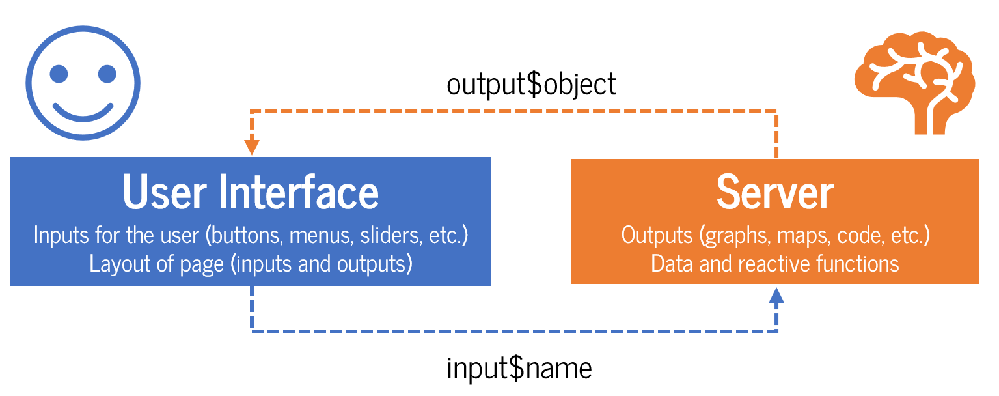
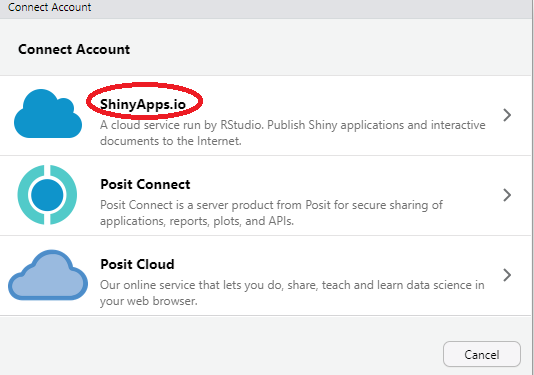
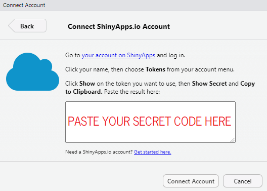

> "*The internet broke the private-public wall; impulsive and inelegant utterances that used to be kept private are now available for literal interpretation.*" <br>-- N. N. Taleb

One of the best things about working with R is publishing your work online. The possibilities are endless: blogs, books, articles, games, dashboards can all be published from R. You already know [Quarto](https://quarto.org/) is a great builder of HTML and interactive content.

In this lesson you will learn how to build apps. Let's get started.

::: {.lesson-info}
**Level:** Advanced &nbsp;·&nbsp; **Time:** ~90 min &nbsp;·&nbsp; **Prerequisites:** Everything in its right place &nbsp;·&nbsp; **Tools:** shiny, bslib, shinyWidgets, plotly
:::

## You will learn to

- Structure a Shiny app around its two halves: the UI and the server.
- Build reactive inputs and outputs so the app updates itself as the user interacts with it.
- Theme an app with bslib and Bootswatch.
- Publish a Shiny app online and embed it in a Quarto page.
- Build a RevealJS presentation as a bonus output format.

## PART I: The real beauty of R

My favourite tool is Shiny for a simple reason --immediacy. Shiny allows full and immediate interactivity between inputs and outputs. It is very simple to build and quite flexible in [structure](https://rstudio.github.io/shinydashboard/structure.html), but in general every Shiny app has two parts: The **User Interface**, the face, and the **Server**, the brain. The user makes choices in the user interface over *inputs*, which are sent to the server to be calculated or reflected into *outputs*, which are then displayed in the user interface.

{width="800px" fig-align="center"}

Look at some great examples of Shiny at work:

-   [Spotify habits](https://nicohahn.shinyapps.io/spotify_habits/)
-   [Blog explorer](https://nz-stefan.shinyapps.io/blog-explorer/)
-   [Datify](https://kneijenhuijs.shinyapps.io/Datify)
-   [iSEE (interactive SummarizedExperiment Explorer)](https://kevinrue.shinyapps.io/isee-shiny-contest/)
-   [69 Love Songs: A Lyrical Analysis](https://committedtotape.shinyapps.io/sixtyninelovesongs/)

::: callout-tip
## Publish your apps online for free

Open a free [Shinyapps.io](https://www.shinyapps.io/) account to host your app online
:::

### 💔 Two apps on infidelity for the price of one

We'll build 2 apps on the same data using different options, just to showcase how versatile Shiny is. We'll use data from a survey carried out in 1969: 601 married adults were asked about infidelity --a difficult topic to inquire about because people probably are not super honest about their responses.

#### App I 🎬: `page_sidebar`

The first app is simple on purpose: one input, three outputs. The **User Interface (UI)** of a dashboard with a sidebar starts with `page_sidebar()` and includes a `sidebar()`, where inputs usually go. In the sidebar we put a `selectInput()` that filters the data by how happy respondents said their marriage was, and a small reference plot of all marriages, `plotOutput("happiness")`, which highlights the group you picked. We theme the app with `bs_theme()` from **`bslib`**, the same tool behind your blog's look.

::: column-margin

:::

The body of the app is a [`card()`](https://rstudio.github.io/bslib/articles/cards.html), which boxes whatever you put inside it: a header with a one-line summary of the group (a `textOutput()`), and our main output, a `plotOutput()` where the filtered graph will be displayed.

The app shows, for the marriages you pick, how many respondents of each age and gender reported at least one affair in the past year.

```{r 8.shiny-sidebar}
#| eval: false
#| code-fold: true

# Packages ####
library(shiny)
library(bslib)
library(dplyr)
library(ggplot2)

# Data ####
affairs_1969 <- readr::read_csv( # <1>
  "https://raw.githubusercontent.com/vincentarelbundock/Rdatasets/master/csv/AER/Affairs.csv",
  show_col_types = FALSE
) |>
  dplyr::mutate(
    happy = factor(rating, levels = 1:5, # <2>
                   labels = c("Very unhappy", "Somewhat unhappy", "Average",
                              "Happier than average", "Very happy")),
    affair = factor(if_else(affairs > 0, "Had an affair", "No affair"), # <3>
                    levels = c("No affair", "Had an affair")),
    gender = if_else(gender == "female", "Women", "Men")
  )

# Look ####
teal <- "#226F7F"; orange <- "#F75431"; slate <- "#5C6B70"

theme_r4dev <- function(base_size = 13) { # <4>
  theme_minimal(base_size = base_size) +
    theme(plot.title.position = "plot",
          plot.title = element_text(face = "bold"),
          plot.subtitle = element_text(colour = slate),
          axis.title = element_text(colour = slate),
          panel.grid.minor = element_blank(),
          panel.grid.major.x = element_blank(),
          strip.text = element_text(face = "bold", size = rel(1.1), hjust = 0),
          legend.position = "top", legend.justification = "left")
}

# User interface ####
ui <- page_sidebar( # <5>
  title = "Fair's Affairs, 1969",
  theme = bs_theme( # <6>
    version = 5, primary = teal, secondary = slate,
    base_font = font_google("Roboto Condensed", wght = c(400, 700)),
    "navbar-bg" = teal,
    brand = FALSE
  ),
  sidebar = sidebar( # <7>
    width = 320,
    p("In 1969, ", tags$em("Psychology Today"), " asked 601 married readers how happy their marriage was, ",
      "and how often they had been unfaithful in the past year."),
    selectInput( # <8>
      inputId = "happy",
      label = "Show respondents whose marriage is…",
      choices = levels(affairs_1969$happy),
      selected = "Average"
    ),
    plotOutput("happiness", height = "190px"), # <9>
    p(class = "small text-muted",
      "Source: Fair (1978), via the AER package.")
  ),
  card( # <10>
    full_screen = TRUE,
    card_header(textOutput("headline")),
    plotOutput("affairs")
  )
)

# Server ####
server <- function(input, output) { # <11>

  # How happy were the marriages? The bar you picked is highlighted
  output$happiness <- renderPlot({ # <12>
    affairs_1969 |>
      dplyr::count(happy) |>
      dplyr::mutate(picked = happy == input$happy) |> # <13>
      ggplot(aes(x = n, y = happy, fill = picked)) +
      geom_col(width = 0.75) +
      geom_text(aes(label = n), hjust = -0.2, size = 3.6, colour = slate) +
      scale_fill_manual(values = c(`TRUE` = teal, `FALSE` = "#C9D3D6"), guide = "none") +
      scale_x_continuous(expand = expansion(mult = c(0, 0.3))) +
      labs(x = NULL, y = NULL, title = "Respondents by marriage rating") +
      theme_r4dev(11) +
      theme(axis.text.x = element_blank(), panel.grid = element_blank(),
            plot.title = element_text(size = 10, colour = slate))
  }, res = 96)

  # Headline for the selected group
  output$headline <- renderText({ # <14>
    group <- dplyr::filter(affairs_1969, happy == input$happy)
    sprintf("%s marriages: %d of %d respondents (%.0f%%) reported an affair",
            input$happy, sum(group$affairs > 0), nrow(group),
            100 * mean(group$affairs > 0))
  })

  # Who strayed, by age and gender, within the selected group
  output$affairs <- renderPlot({
    affairs_1969 |>
      dplyr::filter(happy == input$happy) |> # <15>
      dplyr::count(gender, age, affair) |>
      ggplot(aes(x = age, y = n, fill = affair)) +
      geom_col(width = 4) +
      facet_wrap(~gender) +
      scale_fill_manual(values = c("No affair" = "#C9D3D6", "Had an affair" = orange)) +
      scale_x_continuous(breaks = c(17.5, 22, 27, 32, 37, 42, 47, 52, 57),
                         labels = c("<20", "22", "27", "32", "37", "42", "47", "52", "57")) +
      scale_y_continuous(expand = expansion(mult = c(0, 0.05))) +
      labs(title = "Respondents by age and gender",
           subtitle = "Each bar is one age group; orange marks those who reported at least one affair",
           x = "Age (years)", y = "Respondents", fill = NULL) +
      theme_r4dev()
  }, res = 96)
}

# Run the app ####
shinyApp(ui = ui, server = server) # <16>
```

1.  We download the data straight from the [Rdatasets](https://vincentarelbundock.github.io/Rdatasets/) repository on GitHub.
2.  `factor()` with `levels` and `labels` turns the 1--5 ratings into readable labels in one step. The order of the levels is the order of the bars in every plot.
3.  `affairs` counts affairs in the past year; we only need to know whether there was at least one.
4.  Colours stored once and a small ggplot theme function, so every plot in the app shares the same look.
5.  `page_sidebar()` lays out the page: a title bar, a sidebar on the left and a main area.
6.  `bs_theme()` styles the whole app: a primary colour for buttons and sliders, a Google font, and the colour of the title bar (`navbar-bg`). `brand = FALSE` stops bslib from looking for a `_brand.yml` file in parent folders.
7.  The `sidebar()` holds the input, but also text and even a plot. `p()` writes a paragraph (an HTML `<p>` tag) and `tags$em()` sets italics.
8.  The one input. Its `inputId`, *happy*, becomes `input$happy` on the server.
9.  First output slot: a `plotOutput()` we call *happiness*.
10. The main area is a `card()`. `full_screen = TRUE` adds an expand button, and the header holds a `textOutput()` called *headline*.
11. The server function, with its inputs and outputs.
12. `renderPlot()` fills the slot we called *happiness* in the UI.
13. Here is where UI and server connect: the bar matching `input$happy` is coloured, so even the reference plot reacts to the selector.
14. `renderText()` fills the *headline* slot with a sentence computed from the data.
15. `input$happy` filters the data behind the main plot. Change the selector and every output that reads `input$happy` re-runs.
16. We combine the UI and server objects in `shinyApp()` and watch the magic unfold.

::: column-screen-inset-right
<iframe src="https://nelsonamayad-r4dev-fair-s-affairs-sidebar.share.connect.posit.cloud/" title="Fair's Affairs 1969: sidebar app" style="border: none; width: 100%; height: 650px" frameborder="0">

</iframe>
:::

#### App 2 🎬: `page_navbar`

The second app is fancier: more pages, more interactivity, and a few design habits worth stealing.

The layout is a navigation bar, `page_navbar()` from **`bslib`**, with three pages defined by `nav_panel()`: *Overview*, *Who strays?* and *About the data*. Each page has a title and an icon from [Bootstrap Icons](https://icons.getbootstrap.com/), via `bsicons::bs_icon()`. `nav_spacer()` pushes a link back to this lesson to the right-hand edge.

The sidebar is passed to `page_navbar()` itself, so **the same filters apply on every page**. Two of them are `radioGroupButtons()` from [**`shinyWidgets`**](https://dreamrs.github.io/shinyWidgets/), an extension package with dozens of nicer-looking inputs; the third is a plain `sliderInput()` with two handles, which selects a range.

Each page is built from [`card()`](https://rstudio.github.io/bslib/articles/cards.html)s and [`value_box()`](https://rstudio.github.io/bslib/articles/value-boxes.html)es. The value boxes are built on the server with `renderUI()` and placed in the UI with `uiOutput()`, because their values change with the filters. `layout_columns()` and `layout_column_wrap()` arrange everything in rows that wrap on small screens.

Output elements include a `girafeOutput()` for an interactive **`ggiraph`** plot, a `DTOutput()` for an interactive table, and three `plotOutput()`s. On the server, three ideas do the heavy lifting:

-   **One filtered data set.** Instead of repeating the filters inside every output, a single `reactive()` called `filtered()` applies them once, and every output reads it. This is a first taste of *reactivity*, which PART II explains properly.
-   **Linked outputs.** `girafe` stores the bars you click in `input$<outputId>_selected` (here, `input$by_rating_selected`), using the `data_id` of each bar. The table reads that input and shows only those respondents. This feature makes `ggiraph` one of the most powerful packages to work with in Shiny.
-   **Functions, not copies.** The three plots on *Who strays?* differ only in the variable on the x-axis, so they all call one function, `rate_plot()`. If you catch yourself copy-pasting a `renderPlot()` block, write a function instead.

::: column-margin

:::

Here is the code and the resulting app:

```{r 8.shinyapp-navbar}
#| eval: false
#| code-fold: true

# Packages ####
library(shiny)
library(bslib)
library(bsicons)
library(shinyWidgets)
library(dplyr)
library(ggplot2)
library(ggiraph)
library(DT)

# Data ####
affairs_1969 <- readr::read_csv(
  "https://raw.githubusercontent.com/vincentarelbundock/Rdatasets/master/csv/AER/Affairs.csv",
  show_col_types = FALSE
) |>
  dplyr::mutate(
    happy = factor(rating, levels = 1:5,
                   labels = c("Very unhappy", "Somewhat unhappy", "Average",
                              "Happier than average", "Very happy")),
    strayed = affairs > 0,
    gender = if_else(gender == "female", "Women", "Men"),
    children = if_else(children == "yes", "Yes", "No"),
    # yearsmarried codes the first year in three slices; pool them for plotting
    married = if_else(yearsmarried < 1, 0.5, yearsmarried)
  )

# Look ####
pal <- list(teal = "#226F7F", rust = "#C2401F", slate = "#5C6B70", ink = "#20242A",
            women = "#0E8CA8", men = "#F75431")   # validated series pair

r4dev_theme <- bs_theme(
  version = 5, primary = pal$teal, secondary = pal$slate, danger = pal$rust,
  base_font = font_google("Roboto Condensed", wght = c(400, 700)),
  "navbar-bg" = pal$teal,
  brand = FALSE
) |>
  bs_add_rules("
    .bslib-value-box .value-box-title { font-size: .9rem; }
    .bslib-value-box .value-box-value { font-weight: 700; }
    .card-header { font-weight: 700; }
    .btn-group .btn { font-size: .85rem; }
    .bslib-grid > * { min-width: 0; }
    .bslib-page-main { min-width: 0 !important; }   /* let narrow iframes wrap instead of scroll */
    table.dataTable { font-size: .85rem; }
    table.dataTable td { padding-top: .3rem !important; padding-bottom: .3rem !important; }
  ")

theme_r4dev <- function(base_size = 13) {
  theme_minimal(base_size = base_size) +
    theme(plot.title.position = "plot",
          axis.title = element_text(colour = pal$slate),
          panel.grid.minor = element_blank(),
          legend.position = "top", legend.justification = "left")
}

pct <- function(x) sprintf("%.0f%%", 100 * x)

# One function, three plots: the share who strayed along any variable
rate_plot <- function(data, var, x_lab, breaks = waiver(), labels = waiver()) {
  data |>
    dplyr::group_by(gender, value = .data[[var]]) |>
    dplyr::summarise(rate = mean(strayed), n = dplyr::n(), .groups = "drop") |>
    dplyr::arrange(gender, value) |>
    ggplot(aes(value, rate, colour = gender)) +
    geom_line(linewidth = 1) +
    geom_point(aes(size = n)) +
    scale_colour_manual(values = c(Women = pal$women, Men = pal$men)) +
    scale_size_area(max_size = 6, guide = "none") +
    scale_x_continuous(breaks = breaks, labels = labels) +
    scale_y_continuous(labels = scales::label_percent(), limits = c(0, NA)) +
    labs(x = x_lab, y = "Reported an affair", colour = NULL) +
    theme_r4dev()
}

# User interface ####
ui <- page_navbar(
  title = "Fair's Affairs, 1969",
  theme = r4dev_theme,
  fillable = FALSE,

  # The sidebar is shared by every page
  sidebar = sidebar(
    title = "Filter respondents",
    width = 280,
    shinyWidgets::radioGroupButtons(
      "gender", "Gender", choices = c("All", "Women", "Men"),
      justified = TRUE, status = "outline-primary"
    ),
    shinyWidgets::radioGroupButtons(
      "children", "Has children", choices = c("Any", "Yes", "No"),
      justified = TRUE, status = "outline-primary"
    ),
    sliderInput("years", "Years married", min = 0, max = 15, value = c(0, 15), step = 1),
    p(class = "small text-muted mt-2",
      "601 married readers of ", tags$em("Psychology Today"),
      " (1969). Source: Fair (1978), via the AER package.")
  ),

  # Page 1 ####
  nav_panel(
    "Overview", icon = bs_icon("heartbreak"),
    layout_column_wrap(
      width = "200px", fill = FALSE,
      uiOutput("box_n"), uiOutput("box_rate"), uiOutput("box_gap")
    ),
    layout_column_wrap(
      width = "340px",
      card(
        full_screen = TRUE, height = "440px",
        card_header("Is an unhappy marriage a warning sign?"),
        girafeOutput("by_rating"),
        card_footer(class = "small text-muted",
                    "Click one or more bars to list those respondents in the table.")
      ),
      card(
        full_screen = TRUE, height = "440px",
        card_header(textOutput("table_title", inline = TRUE)),
        DTOutput("table")
      )
    )
  ),

  # Page 2 ####
  nav_panel(
    "Who strays?", icon = bs_icon("people"),
    layout_column_wrap(
      width = "260px", heights_equal = "row",
      card(full_screen = TRUE, height = "420px", card_header("By years of marriage"), plotOutput("by_years")),
      card(full_screen = TRUE, height = "420px", card_header("By age"), plotOutput("by_age")),
      card(full_screen = TRUE, height = "420px", card_header("By religiousness"), plotOutput("by_religion"))
    ),
    p(class = "small text-muted mb-0",
      "Share of respondents reporting at least one affair in the past year. ",
      "Bigger points mean more respondents, so the estimate is less noisy.")
  ),

  # Page 3 ####
  nav_panel(
    "About the data", icon = bs_icon("info-circle"),
    card(
      card_body(
        markdown("
In 1969 the magazine *Psychology Today* surveyed its readers about sex and marriage.
Ray Fair (1978) used the 601 answers from people in their first marriage to model
*A Theory of Extramarital Affairs*. Each row is one respondent:

- **affairs**: how often they had an affair in the past year (0, 1, 2, 3, 7 = 4–10 times, 12 = monthly or more)
- **rating**: self-rated happiness of the marriage, from 1 (very unhappy) to 5 (very happy)
- **gender**, **age**, **yearsmarried**, **children**, **religiousness** (1–5), **education** (years), **occupation** (1–7)

Keep the caveats in mind: readers of one magazine are not a random sample of
married Americans, and people under-report what they'd rather hide.
")
      )
    )
  ),
  nav_spacer(),
  nav_item(tags$a(
    bs_icon("book"), "Lesson",
    href = "https://nelsonamayad.github.io/R4DEV/sessions_workshop/08-shiny/08-shiny.html",
    target = "_blank"
  ))
)

# Server ####
server <- function(input, output, session) {

  # Every output reads this one filtered data set
  filtered <- reactive({
    d <- affairs_1969 |>
      dplyr::filter(yearsmarried >= input$years[1], yearsmarried <= input$years[2])
    if (input$gender != "All") d <- dplyr::filter(d, gender == input$gender)
    if (input$children != "Any") d <- dplyr::filter(d, children == input$children)
    d
  })

  # Value boxes ####
  output$box_n <- renderUI({
    value_box(
      title = "Respondents selected",
      value = nrow(filtered()),
      theme = "primary", max_height = "100px"
    )
  })
  output$box_rate <- renderUI({
    d <- filtered()
    value_box(
      title = "Reported an affair",
      value = if (nrow(d) > 0) pct(mean(d$strayed)) else "—",
      theme = "danger", max_height = "100px"
    )
  })
  output$box_gap <- renderUI({
    d <- filtered()
    unhappy <- d$strayed[d$rating <= 2]
    happy <- d$strayed[d$rating >= 4]
    value_box(
      title = "Unhappy vs happy marriages",
      value = if (length(unhappy) > 0 && length(happy) > 0)
        paste(pct(mean(unhappy)), "vs", pct(mean(happy))) else "—",
      theme = "light", max_height = "100px"
    )
  })

  # Interactive chart: the share who strayed, by marriage rating ####
  output$by_rating <- renderGirafe({
    rates <- filtered() |>
      dplyr::group_by(happy) |>
      dplyr::summarise(rate = mean(strayed), strayed = sum(strayed), n = dplyr::n())

    gg <- ggplot(rates, aes(x = rate, y = happy)) +
      ggiraph::geom_col_interactive(
        aes(data_id = happy,
            tooltip = sprintf("%s marriages<br>%d of %d reported an affair (%s)",
                              happy, strayed, n, pct(rate))),
        fill = pal$women, width = 0.7
      ) +
      geom_text(aes(label = pct(rate)), hjust = -0.2, colour = pal$slate, size = 4.6) +
      scale_x_continuous(labels = scales::label_percent(),
                         expand = expansion(mult = c(0, 0.15))) +
      labs(x = "Reported an affair", y = NULL) +
      theme_r4dev(16) +
      theme(panel.grid.major.y = element_blank())

    ggiraph::girafe(
      ggobj = gg, width_svg = 6, height_svg = 3.6,
      options = list(
        ggiraph::opts_selection(type = "multiple", css = "fill:#F75431;"),
        ggiraph::opts_hover(css = "fill:#C2401F;cursor:pointer;"),
        ggiraph::opts_toolbar(saveaspng = FALSE),
        ggiraph::opts_sizing(rescale = TRUE)
      )
    )
  })

  # Table: the respondents behind the bars you clicked ####
  # ggiraph stores the clicked data_ids in input$<outputId>_selected
  table_data <- reactive({
    d <- filtered()
    picked <- input$by_rating_selected
    if (length(picked) > 0) d <- dplyr::filter(d, happy %in% picked)
    d
  })

  output$table_title <- renderText({
    picked <- input$by_rating_selected
    if (length(picked) == 0) {
      sprintf("All %d respondents", nrow(table_data()))
    } else {
      sprintf("%d respondents in: %s", nrow(table_data()), paste(picked, collapse = ", "))
    }
  })

  output$table <- renderDT({
    table_data() |>
      dplyr::transmute(
        Gender = gender, Age = age, `Years married` = yearsmarried,
        Children = children, Marriage = happy, Religiousness = religiousness,
        Education = education, `Affairs (past year)` = affairs
      ) |>
      DT::datatable(
        rownames = FALSE, style = "bootstrap5", class = "compact hover nowrap",
        options = list(pageLength = 7, dom = "tip", scrollX = TRUE)
      )
  })

  # Page 2: the same function, three variables ####
  output$by_years <- renderPlot({
    rate_plot(filtered(), "married", "Years married",
              breaks = c(0.5, 4, 7, 10, 15), labels = c("<1", "4", "7", "10", "15+"))
  }, res = 96)
  output$by_age <- renderPlot({
    rate_plot(filtered(), "age", "Age (years)", breaks = seq(22, 57, 10))
  }, res = 96)
  output$by_religion <- renderPlot({
    rate_plot(filtered(), "religiousness", "Religiousness",
              breaks = 1:5, labels = c("None", "2", "3", "4", "Very"))
  }, res = 96)
}

# Run the app ####
shinyApp(ui, server)
```

::: column-screen-inset-right
<iframe src="https://nelsonamayad-r4dev-fair-s-affairs-navbar.share.connect.posit.cloud/" title="Fair's Affairs 1969: navbar app" style="border: none; width: 100%; height: 750px" frameborder="0">

</iframe>
:::

### Infidelity apps, side by side

Look at the two deployed apps side by side:

::: {#infidelity .column-screen-inset layout-ncol="2"}
```{=html}
<iframe src="https://nelsonamayad-r4dev-fair-s-affairs-sidebar.share.connect.posit.cloud/" title="Fair's Affairs 1969: sidebar app" style="border: none; width: 100%; height: 700px" frameborder="0">
</iframe>
```
```{=html}
<iframe src="https://nelsonamayad-r4dev-fair-s-affairs-navbar.share.connect.posit.cloud/" title="Fair's Affairs 1969: navbar app" style="border: none; width: 100%; height: 700px" frameborder="0">
</iframe>
```
:::

### Deploying ShinyApps 🚀

When you create an App and run it from your computer, only you can access it. But if you want to make it public, you need to deploy it to your account, which will run the app on a server for anyone to see.

To deploy the app you need to register your Shinyapps.io account in RStudio following the steps below.

::: {#shinyapps layout-ncol="2"}
{width="100%"}

{width="100%"}
:::

::: callout-tip
## How do you embed a Shiny app in a website?

The apps above are hosted on Posit Connect Cloud and run on its servers, but can be accessed directly in this site by using the **iframe** HTML.

To embed a deployed ShinyApp in your blog, just place the URL inside of an iframe src outside of a code chunk:

```         
<iframe src="YOUR SHINYAPP URL" title="What the app does"></iframe>
```

On Posit Connect Cloud, use the app's **share URL** (it ends in `share.connect.posit.cloud`). The dashboard address that `rsconnect::deployApp()` prints refuses to load inside an iframe, so the embed stays blank.
:::

## PART II: Shiny, in all its glory

Now let's build a proper Shiny app that brings together elements from previous sessions --data from an API, an interactive map and an interactive plot-- to watch the planet shake in near real time: every earthquake of magnitude 4.5 or more recorded in the last 30 days.

We'll look at each part of the app separately and then put them together.

### The Data 📊

The [US Geological Survey](https://earthquake.usgs.gov/earthquakes/feed/v1.0/geojson.php) publishes a free, keyless feed of recent earthquakes as **GeoJSON**, refreshed every few minutes. Each earthquake is a *point*: a magnitude, a place name, a time, and a pair of coordinates (plus depth). That's all we need to map it --no country borders or shapefiles to download.

We wrap the download in a function, `read_quakes()`, rather than running it once at the top of the script. That way the app can call it again whenever the user asks for fresh data.

```{r 8.shiny-quakes-data}
#| eval: false

library(dplyr)
library(purrr)
library(jsonlite)

read_quakes <- function(feed = "4.5_month") { # <1>
  raw <- jsonlite::fromJSON( # <2>
    paste0("https://earthquake.usgs.gov/earthquakes/feed/v1.0/summary/", feed, ".geojson")
  )
  coords <- raw$features$geometry$coordinates # <3>

  tibble::tibble(
    place    = raw$features$properties$place,
    mag      = raw$features$properties$mag,
    lon      = purrr::map_dbl(coords, 1), # <4>
    lat      = purrr::map_dbl(coords, 2),
    depth_km = purrr::map_dbl(coords, 3),
    time     = as.POSIXct(raw$features$properties$time / 1000, origin = "1970-01-01", tz = "UTC") # <5>
  ) |>
    dplyr::filter(!is.na(mag), !is.na(lon), !is.na(lat)) |>
    dplyr::mutate(depth = cut(depth_km, c(-Inf, 70, 300, Inf), # <6>
                              labels = c("Shallow (< 70 km)", "Intermediate", "Deep (> 300 km)"))) |>
    dplyr::arrange(dplyr::desc(time))
}

quakes <- read_quakes()
```

1. USGS publishes several feeds (`significant_week`, `2.5_day`, `all_hour`...). We default to magnitude 4.5+ over the past month: usually a few hundred rows, a comfortable size for an app.
2. `fromJSON()` reads straight from the URL and simplifies the nested GeoJSON into data frames and lists.
3. Coordinates come as a *list* with one `c(longitude, latitude, depth)` vector per earthquake.
4. `map_dbl(coords, 1)` pulls the first element out of every vector --a compact `purrr` trick you'll meet properly in [Do it well, do it fast](/sessions_workshop/10-parallel/10-parallel.qmd).
5. USGS stores time as milliseconds since 1 January 1970, so we divide by 1000 and convert to a date-time.
6. `cut()` sorts every earthquake into the three depth classes seismologists use: shallow (under 70 km), intermediate, and deep (over 300 km).

### The UI 🙂

We start with `page_sidebar()`, the same layout as App I, and give the app a title and a theme with `bslib`. An earlier version of this app wore the psychedelic *quartz* Bootswatch theme, to show how much one theme changes a dashboard; now it wears the R4DEV colours and font. Colour, fonts, buttons --all are parameters you can customise with `bs_theme()`. The title bar also holds a light/dark switch.

Then comes the `sidebar`, where we organise our **inputs**. There are four: a **button** to download fresh data, a **slider** for the minimum magnitude, another for how many days back to look, and **radio buttons** to choose the map projection. Under the button, a line of text reports when the feed was last downloaded.

The main area has two parts. A row of three `value_box`es (built on the server and placed here with `uiOutput`) summarises what's on screen. Under it, `navset_card_underline()` makes a single card with three tabs: a map, a timeline and a table. The map and the timeline are made with **plotly**, so they use `plotlyOutput()`; the table uses `tableOutput()`. The IDs we give them here (`"map"`, `"mag_time"`, `"strongest"`) must match the names we fill in on the server.

```{r 8.shiny-quakes-ui}
#| eval: false

library(shiny)
library(bslib)
library(bsicons)
library(plotly)

ui <- page_sidebar(
  theme = bslib::bs_theme( # <1>
    version = 5,
    primary = "#226F7F", secondary = "#5C6B70", danger = "#C2401F",
    base_font = bslib::font_google("Roboto Condensed", wght = c(400, 700)),
    "navbar-bg" = "#226F7F",
    brand = FALSE
  ),
  title = tags$div(
    class = "d-flex align-items-center gap-2 w-100",
    "Global earthquakes, live",
    tags$div(class = "ms-auto", input_dark_mode(id = "dark_mode", mode = "light", # <2>
                                                style = "--text-1: #fff; --text-2: #fff;"))
  ),
  sidebar = sidebar(
    width = 290,
    markdown("Every earthquake of magnitude 4.5+ in the last 30 days, from the [USGS real-time feed](https://earthquake.usgs.gov/earthquakes/feed/v1.0/geojson.php). Just latitude and longitude: no map files needed."),
    actionButton("update", "Download fresh data", icon = icon("rotate"), class = "btn-primary"), # <3>
    textOutput("downloaded_at"),
    hr(class = "my-1"),
    sliderInput("min_mag", "Minimum magnitude",
                min = 4.5, max = 8, value = 5, step = 0.1), # <4>
    sliderInput("days", "Show the last … days",
                min = 1, max = 30, value = 30, step = 1), # <5>
    radioButtons("projection", "Map projection",
                 choices = c("Flat" = "natural earth", "Globe" = "orthographic"), # <6>
                 inline = TRUE)
  ),
  layout_columns(
    fill = FALSE,
    uiOutput("box_count"), uiOutput("box_strongest"), uiOutput("box_latest") # <7>
  ),
  navset_card_underline( # <8>
    full_screen = TRUE,
    nav_panel("Map", icon = bs_icon("globe-americas"), plotlyOutput("map")),
    nav_panel("Timeline", icon = bs_icon("graph-up"), plotlyOutput("mag_time")),
    nav_panel("Strongest 10", icon = bs_icon("list-ol"), tableOutput("strongest"))
  )
)
```

1. The R4DEV look: brand colours for `primary` (buttons, sliders) and `danger` (one of the value boxes), a Google font, and the colour of the title bar (`navbar-bg`). `brand = FALSE` stops bslib from searching parent folders for a `_brand.yml`. Add `bootswatch = "quartz"` to see how much one argument changes everything.
2. A light/dark switch, for free. Its value reaches the server as `input$dark_mode`, which we use to recolour the plotly charts. The `style` makes the icon white on the teal bar.
3. An `actionButton` does nothing on its own; it just counts clicks. The server decides what a click means.
4. Magnitude is logarithmic: an M6 shakes about ten times harder than an M5. Sliding from 4.5 to 6 hides the great majority of the points.
5. A slider of days rather than a `dateRangeInput()`. A date range built with `Sys.Date()` freezes the day the app *started*, so a server that runs for weeks would offer a stale range. "The last 7 days" stays true forever.
6. The names are what the user sees; the values are what the server receives --here, plotly's names for each projection.
7. Placeholders for UI that the server will build: three value boxes that change with the data.
8. One card, three tabs. Each tab holds one output, and its ID (`"map"`) is the contract between UI and server.

::: callout-tip
## Help! Is there an easier way to design user interfaces?

You can use the [shinyuieditor](https://rstudio.github.io/shinyuieditor/) package to design your UI elements and layout by dragging and dropping.

Start with the [live demo](https://rstudio.github.io/shinyuieditor/live-demo/)
:::

### The Server 🧠

Now we build the server function, where things get interesting for two reasons: **reactive functions** and **events**.

The server function has two main arguments: `input`, which connects the server to the inputs defined in the UI, and `output`, where we store whatever we compute from those inputs --a plot, a table, a map, you name it [^1].

[^1]: A third argument called `session` is often used, but we won't go into that here.

::: callout-note
## What's the point of reactivity in Shiny?

> [*"Reactive programming is a style of programming that focuses on values that change over time, and calculations and actions that depend on those values"*](https://mastering-shiny.org/reactive-motivation.html#motivation) --[@wickham_mastering_2020]

Put differently, reactive functions make it easier to link inputs and outputs by creating an intermediary object that changes with the inputs, so that every change flows through a single object. I know this sounds abstract now, but it will become clear soon.
:::

This app has seven outputs (a line of text, three value boxes, a map, a plot and a table), but before we can render them we build two intermediary steps:

-   **Working with buttons**: downloading the feed takes a second or two, and we don't want to hit USGS every time someone nudges a slider. So we wrap the download in `eventReactive(input$update, ...)`: it runs only when the button is clicked. With `ignoreNULL = FALSE` it also runs once at start-up, so the app never opens empty.

-   **Our reactive function**: filtering a few hundred rows, on the other hand, is instant. So the filtering lives in a plain `reactive()`, which re-runs automatically whenever `input$min_mag` or `input$days` change. Every output reads this filtered data --called like a function, `quakes_shown()`-- and nothing else.

Notice the chain: **button → `quakes()` → `quakes_shown()` ← selectors**, and every chart, box and table hangs off `quakes_shown()`. **Reactivity is not easy and takes practice**, but drawing that chain before you write any code is the best habit you can build, because apps get complex fast and it is easy to lose track of which inputs affect what.

The map itself is a plotly `scattergeo` trace: one marker per earthquake at its longitude/latitude, sized and coloured by magnitude, on a world basemap that plotly draws for us.

```{r 8.shiny-quakes-server}
#| eval: false
#| code-fold: true

# Colours for the plots, in light and dark mode
plot_colours <- function(mode) { # <1>
  if (identical(mode, "dark")) {
    list(land = "#2A3136", ocean = "#151A1E", border = "#3D464C", text = "#DDE3E5",
         depth = c("#F75431", "#4FB3C9", "#C9B6F2"))
  } else {
    list(land = "#E3E7E8", ocean = "#F4F8F9", border = "#FFFFFF", text = "#20242A",
         depth = c("#F75431", "#0E8CA8", "#5B3F8C"))
  }
}

server <- function(input, output, session) {

  # 1. Download the feed: on start-up (ignoreNULL = FALSE) and on every click
  quakes <- eventReactive(input$update, { # <2>
    withProgress(message = "Downloading the USGS feed…", read_quakes())
  }, ignoreNULL = FALSE)

  # 2. Filter it: re-runs instantly whenever a selector moves
  quakes_shown <- reactive({ # <3>
    since <- Sys.time() - input$days * 24 * 60 * 60
    quakes() |>
      dplyr::filter(mag >= input$min_mag, time >= since)
  })

  # 3. The outputs only ever read the filtered data
  output$downloaded_at <- renderText({
    paste0("Feed downloaded at ", format(Sys.time(), "%H:%M UTC", tz = "UTC"),
           " · ", nrow(quakes()), " earthquakes")
  }) |> bindEvent(quakes()) # <4>

  output$box_count <- renderUI({
    value_box(
      title = "Earthquakes shown",
      value = nrow(quakes_shown()),
      theme = "primary"
    )
  })

  output$box_strongest <- renderUI({ # <5>
    d <- quakes_shown()
    top <- dplyr::slice_max(d, mag, n = 1, with_ties = FALSE)
    value_box(
      title = "Strongest",
      value = if (nrow(top) > 0) sprintf("M%.1f", top$mag) else "—",
      p(class = "small mb-0 text-truncate", if (nrow(top) > 0) top$place),
      theme = "danger"
    )
  })

  output$box_latest <- renderUI({
    d <- quakes_shown()
    hours <- if (nrow(d) > 0) as.numeric(difftime(Sys.time(), max(d$time), units = "hours"))
    value_box(
      title = "Most recent",
      value = if (is.null(hours)) "—" else if (hours < 1) "< 1 hour ago"
              else if (hours < 48) paste(round(hours), "hours ago")
              else paste(round(hours / 24), "days ago"),
      p(class = "small mb-0 text-truncate", if (nrow(d) > 0) d$place[1])
    )
  })

  output$map <- renderPlotly({ # <6>
    col <- plot_colours(input$dark_mode)
    plot_ly(
      quakes_shown(),
      type = "scattergeo", mode = "markers",
      lon = ~lon, lat = ~lat,
      marker = list(
        size = ~4 + (mag - 4.5) * 6,
        color = ~mag, cmin = 4.5, cmax = 8,
        colorscale = list(c(0, "#F2C078"), c(0.5, "#F75431"), c(1, "#8C1D0E")),
        colorbar = list(title = "Magnitude", thickness = 12),
        opacity = 0.85, line = list(width = 0.5, color = "rgba(255,255,255,0.6)")
      ),
      text = ~paste0("<b>M", mag, "</b> · ", place,
                     "<br>", format(time, "%d %b %Y, %H:%M UTC"),
                     "<br>depth: ", round(depth_km), " km"),
      hoverinfo = "text"
    ) |>
      layout(
        geo = list(
          projection = list(type = input$projection), # <7>
          showland = TRUE, landcolor = col$land,
          showocean = TRUE, oceancolor = col$ocean,
          showcountries = TRUE, countrycolor = col$border,
          showcoastlines = FALSE, showframe = FALSE,
          bgcolor = "rgba(0,0,0,0)"
        ),
        font = list(color = col$text),
        paper_bgcolor = "rgba(0,0,0,0)",
        margin = list(l = 0, r = 0, t = 0, b = 0)
      ) |>
      config(displaylogo = FALSE)
  })

  output$mag_time <- renderPlotly({
    col <- plot_colours(input$dark_mode)
    plot_ly(
      quakes_shown(), x = ~time, y = ~mag,
      type = "scatter", mode = "markers",
      color = ~depth, colors = col$depth, # <8>
      marker = list(size = 8, opacity = 0.8),
      text = ~paste0("<b>M", mag, "</b> · ", place, "<br>depth: ", round(depth_km), " km"),
      hoverinfo = "text"
    ) |>
      layout(
        legend = list(orientation = "h", y = 1.08, title = list(text = "Depth: ")),
        xaxis = list(title = "", gridcolor = col$border),
        yaxis = list(title = "Magnitude", gridcolor = col$border),
        font = list(color = col$text),
        paper_bgcolor = "rgba(0,0,0,0)", plot_bgcolor = "rgba(0,0,0,0)"
      ) |>
      config(displaylogo = FALSE)
  })

  output$strongest <- renderTable({ # <9>
    quakes_shown() |>
      dplyr::slice_max(mag, n = 10, with_ties = FALSE) |>
      dplyr::transmute(
        Magnitude = sprintf("M%.1f", mag),
        Where = place,
        `When (UTC)` = format(time, "%d %b, %H:%M"),
        `Depth (km)` = as.integer(round(depth_km))
      )
  }, striped = TRUE, hover = TRUE, width = "100%")
}

shinyApp(ui, server) # <10>
```

1. A helper that returns the plot colours for light or dark mode. plotly charts don't follow the page theme on their own, so we tell them.
2. The expensive step, tied to the button: each click re-downloads the feed. `withProgress()` shows a progress bar while it runs.
3. The cheap step, tied to the selectors: re-filters instantly. Note that it *reads* `quakes()`, so a fresh download flows through it too. `Sys.time()` minus a number of seconds gives the cut-off.
4. `bindEvent()` makes this text re-run only when a new download arrives, not every time a slider moves.
5. `renderUI()` builds a piece of UI on the server: here it fills the `uiOutput("box_strongest")` slot, using `slice_max()` to find the strongest earthquake on screen.
6. `renderPlotly()` fills `plotlyOutput("map")`. The `~` formulas map columns of the data to aesthetics, much like `aes()` in ggplot2. Reading `input$dark_mode` (through `plot_colours()`) means the map redraws when the user flips the switch.
7. The projection comes straight from the radio buttons. On `"orthographic"`, drag the globe to spin it.
8. Same data, different view: time on the x-axis, colour by depth class. Deep earthquakes cluster along subduction zones --hover to find them.
9. `renderTable()` returns a plain HTML table: plenty for ten rows.
10. UI + server = app.

::: callout-important
## Why plotly and not leaflet?

You built leaflet maps in [Mapping despair in the USA](/sessions_workshop/06-maps/06-maps.qmd), and leaflet works beautifully *on your own machine*. But to deploy an app, the hosting server must install every package it uses, and their dependencies. `leaflet` depends on `sf`, which depends on `terra`, and in 2026 `terra` fails to compile on the servers of both shinyapps.io and Posit Connect Cloud (their geospatial system libraries are older than what `terra` expects). An app that runs locally but can't be deployed is a lesson in itself: **check your dependency chain before you build**. Plotly draws its own world basemap with no geospatial packages at all, so this app deploys anywhere.
:::

### The Full ShinyApp ✨

Here is the full app, deployed and embedded with an `<iframe>`. Click the button, slide the magnitude, switch tabs --and download the code to run it yourself.

::: column-margin

:::

```{=html}
<iframe src="https://01a1b7a3-1f7c-32bb-3799-3cde672905bb.share.connect.posit.cloud/" style="border: none; width: 100%; height: 750px" frameborder="0" title="Global Earthquakes Shiny app">
</iframe>
```

Making an app quickly is easy, making a good app is not and requires a lot more tinkering to make sure the computations are efficient, and the UI is user-friendly, clear and useful. Otherwise it will be another app in a website nobody has any use for.

::: callout-tip
## Go nuts with Shiny extensions and improve the User Interface

Shiny has a large and expanding universe of extensions, [have a look](https://github.com/nanxstats/awesome-shiny-extensions)

A great source on improving the look of an app is [*Outstanding User Interfaces with Shiny*](https://unleash-shiny.rinterface.com/) [@granjon_outstanding_2020]
:::

## Bonus track: Interactive presentations

### [RevealJS](https://quarto.org/docs/presentations/revealjs/) presentations 🤩

Quarto produces other outputs beyond HTML, Word and PDF. One nice output includes RevealJS presentations, which are easy to do and display results computed in Quarto, so that you can include any object you've learned so far into a presentation directly.

To create a RevealJS presentation you only need to change the format to `format: revealjs` and become familiar with the structure of these presentations. RevealJS also has themes you can use, check them out [here](https://quarto.org/docs/presentations/revealjs/themes.html).

::: column-margin

:::

```{=html}
<iframe width="100%" height="500" src="revealjs.html" title="R4DEV as RevealJS"></iframe>
```
::: callout-tip
## Learn more about RevealJS presentations

Check out [this page](https://quarto.org/docs/presentations/revealjs/)
:::

## 🏗 Practice 8: Shine {.unnumbered}

A Shiny app needs a live R process, so all of this happens in your own R session -- start by running the session's apps, then build your own.

::: {.callout-note icon="false" collapse="true"}
# Basic

-   Run one of this session's apps locally with `shiny::runApp()`, change one input's label and default value, and re-run it
-   Add a new input (a slider or a selector) that filters the data behind one of the app's plots
:::

::: {.callout-important icon="false" collapse="true"}
# Intermediate

-   Replicate the UI and server design of the earthquakes app built above and make it your own: a different USGS feed (try `significant_month` or `2.5_week`), a new input (a depth filter?), or a fourth tab
-   Create a Shiny app that shows the frequency of use of all Eunoia words you scraped, by country. Use **`gtrendsR`** package to look up the frequency of each word by country.
-   Create a Shiny app for your project
:::

::: {.callout-caution icon="false" collapse="true"}
# Advanced

-   Deploy your apps to a free [shinyapps.io](https://www.shinyapps.io/) or [Posit Connect Cloud](https://connect.posit.cloud/) account, embed them into a new blog post with an `<iframe>`, and publish it
-   Create a RevealJS presentation with the best outputs in your blog
:::

## Key takeaways

- Every Shiny app has two halves: a UI that describes the layout, and a server that reacts to input and computes output.
- Reactivity means you describe *what* depends on *what* -- Shiny handles *when* to recompute it.
- bslib/Bootswatch theming works the same way in a Shiny app as it does in a Quarto site.
- A deployed app is embedded elsewhere with a plain `<iframe>`, the same way this lesson embeds its own examples.
- RevealJS presentations are a Quarto output format, not a Shiny feature -- useful any time you need slides from the same source as a report.

::: {.continue-learning}
[← Previous: Just take it](/sessions_workshop/07-scrap/07-scrap.qmd)

[Track overview: Build with R →](/learn/build-with-r.qmd)

[Next: Smart reports →](/sessions_workshop/09-reports/09-reports.qmd)
:::

## References

::: {#refs}
:::
